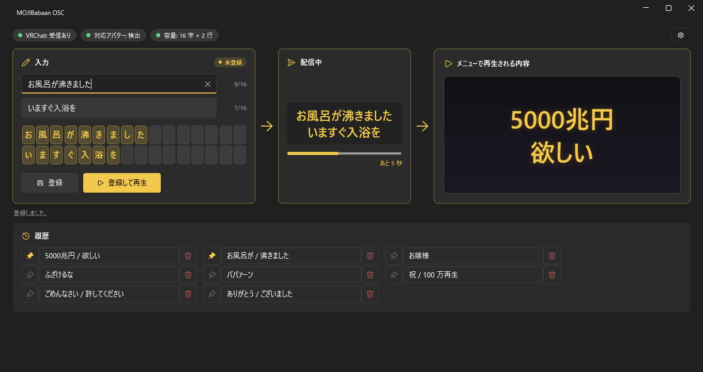
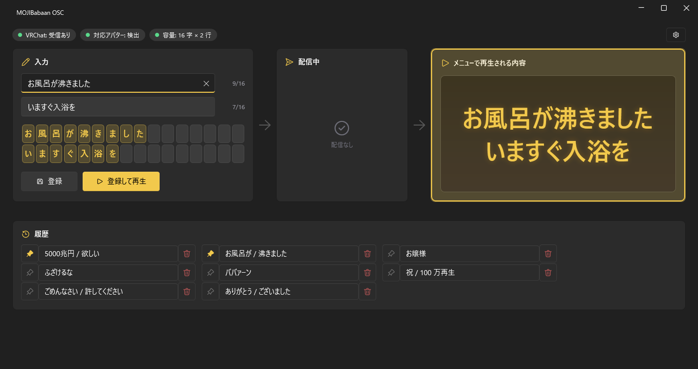

# MOJIBabaan OSC

VRChat アバターギミック「MOJIBabaan」に、好きな文言を外から登録して再生する Windows アプリです。アプリで文言を入れて「登録」すると、アバターの OSC 枠に文字が入り、メニューの OSC 枠（または「登録して再生」）で演出が始まります。

画面は「入力」→「配信中」→「登録済み」の 3 枚のカードが矢印でつながっています。入力が登録済みと違うあいだは、矢印が金色でゆっくり点滅し、入力に「未登録」と出ます。





## 必要なもの

- Windows 10 / 11（PC 版 VRChat 専用）
- VRChat で OSC を有効にしていること
- MOJIBabaan を入れたアバター

## 使い方

1. VRChat のラジアルメニューで「Options」から「OSC」を開き、「Enabled」にします。
2. アバターに MOJIBabaan を着て、ワールドに入ります。
3. `MOJIBabaan-OSC.exe` を起動します。画面上部が「VRChat: 受信あり」「対応アバター: 検出」になれば準備完了です。
4. 「入力」に 1 行目、2 行目の文言を入れます（各 16 文字まで）。マスのプレビューで、送られる字を確認します。
   1 行目が上限を超えると、超えた分が 2 行目の先頭へ移り、カーソルも 2 行目へ移ります（貼り付けでも同じです）。
5. 「登録」を押します。入力が「配信中」へ移り、全員に届くまでの進み具合が出ます。Enter キーでも登録できます。
6. VRChat のメニューの OSC 枠を押すと演出が始まります。「登録して再生」は、全員に届くのを待って自動で再生します。

「登録済み」には、アバターから読み取った内容が VRChat での見た目に近い形で出ます。受け取るまでは「受信待ち」です。内容が入れ替わった瞬間に、カードが短く光ります。

履歴は直近 50 件です。左のピンで留め（50 件に数えません）、右のゴミ箱で消します（確認なしで、ピン留め中も消せます）。文言をクリックすると入力に戻ります。履歴は `%AppData%\MOJIBabaan-OSC\history.json` に保存されます。

右上の歯車で、送信先 IP とポート（既定 127.0.0.1:9000）、受信ポート（既定 9001）を変えられます。

## OSCQuery について

既定で OSCQuery（VRChat 公式の仕組み）を使います。受信ポートを VRChat に知らせるので、他の OSC アプリと 9001 を取り合いません。VRChat の送信先ポートと、アバターの現在の登録内容も自動で取得します。使えない場合は、UDP 9001 を直接待ち受ける動作に切り替わります。この場合、対応アバターの判定は VRChat の OSC 設定ファイル（`%USERPROFILE%\AppData\LocalLow\VRChat\VRChat\OSC`）で行います。

## アバターの容量（1 行の字数）

アバターの容量に合わせて、入力できる字数が切り替わります。画面上部の「容量」で確認できます。

- `BBN/O31h` があるアバター: 16 字 × 2 行（32 セル）
- `BBN/O19h` までのアバター（旧版）: 10 字 × 2 行（20 セル）
- 判定できないとき: 16 字で入力でき、登録時に警告が出ます。10 字/行のアバターでは後半が欠けます。

## 制限

- PC 専用です（Quest 単体では使えません）。
- 文字表にない字は空白になります。プレビューで赤いマスになります。
- 1 行 16 文字（旧アバターは 10 文字）、2 行までです。2 行目が超えた分は送られず、赤く出ます。
- 登録してから全員に届くまで、32 セルで約 6.6 秒、20 セルで約 4.2 秒かかります。アプリは余裕を 1.2 秒足して待ちます。
- 全角英数字と全角スペースは半角に、半角カナは全角カナにそろえて送ります。

## ビルド

.NET SDK 9 が必要です。

```
dotnet build -c Release
dotnet test -c Release
dotnet publish src/MOJIBabaan.Osc.App -c Release -r win-x64 --self-contained true -p:PublishSingleFile=true -p:IncludeNativeLibrariesForSelfExtract=true -o artifacts/publish
```

画面の見本画像は `MOJIBabaan-OSC.exe --snapshot out.png --state idle|dirty|sending|received` で書き出せます。失敗したときは `artifacts\snapshot_error.log` に出ます。

構成は次のとおりです。

- `src/MOJIBabaan.Osc.Core` 正規化、自動折り返し、文字表、OSC のエンコードとデコード、容量の判定、履歴
- `src/MOJIBabaan.Osc.App` WPF の画面（[WPF-UI](https://github.com/lepoco/wpfui)）
- `tests/MOJIBabaan.Osc.Core.Tests` 単体テストと UDP の結合テスト

`v` で始まるタグ（例 `v0.1.0`）を push すると、GitHub Actions がビルドとテストのあと、単一ファイルの exe を ZIP にして Release に添付します。

## ライセンス

未定（後で決める）