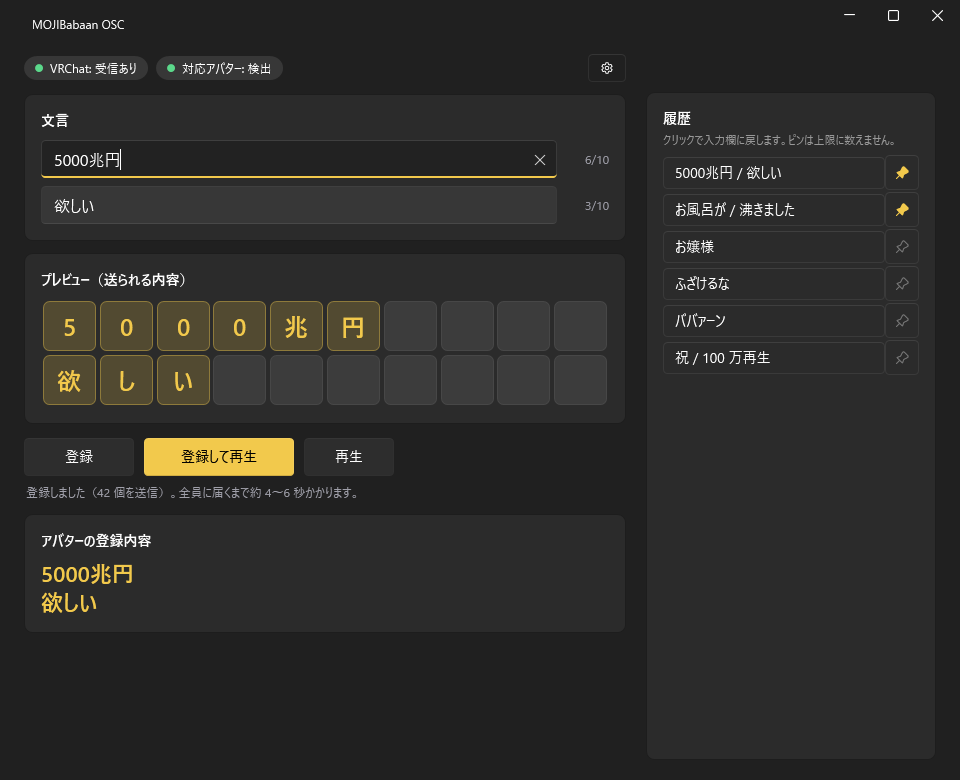

# MOJIBabaan OSC

VRChat アバターギミック「MOJIBabaan」に、好きな文言を外から登録して再生する Windows アプリです。アプリで文言を入れて「登録」すると、アバターの OSC 枠に文字が入り、メニューの OSC 枠（またはアプリの「再生」）で演出が始まります。



## 必要なもの

- Windows 10 / 11（PC 版 VRChat 専用）
- VRChat で OSC を有効にしていること
- MOJIBabaan を入れたアバター

## 使い方

1. VRChat のラジアルメニューで「Options」から「OSC」を開き、「Enabled」にします。
2. アバターに MOJIBabaan を着て、ワールドに入ります。
3. `MOJIBabaan-OSC.exe` を起動します。画面上部が「VRChat: 受信あり」「対応アバター: 検出」になれば準備完了です。
4. 1 行目、2 行目に文言を入れます（各 10 文字まで）。プレビューで送られる文字を確認します。
5. 「登録」を押します。アバターの OSC 枠に文言が入ります。Enter キーでも登録できます。
6. VRChat のメニューの OSC 枠を押すと演出が始まります。アプリの「再生」でも同じです。
7. 「登録して再生」は、登録してから 6 秒待って再生します。登録直後だと、他の人に古い文言が一部見えることがあるため、全員に届くまで待ちます。

「アバターの登録内容」には、アバターが今持っている文言が出ます。VRChat から値を受け取るまでは「不明」です。履歴は直近 50 件で、クリックすると入力欄に戻ります。ピン留めした文言は 50 件に数えません。履歴は `%AppData%\MOJIBabaan-OSC\history.json` に保存されます。

右上の歯車で、送信先 IP とポート（既定 127.0.0.1:9000）、受信ポート（既定 9001）を変えられます。

## OSCQuery について

既定で OSCQuery（VRChat 公式の仕組み）を使います。受信ポートを VRChat に知らせるので、他の OSC アプリと 9001 を取り合いません。VRChat の送信先ポートと、アバターの現在の登録内容も自動で取得します。使えない場合は、UDP 9001 を直接待ち受ける動作に切り替わります。この場合、対応アバターの判定は VRChat の OSC 設定ファイル（`%USERPROFILE%\AppData\LocalLow\VRChat\VRChat\OSC`）で行います。

## 制限

- PC 専用です（Quest 単体では使えません）。
- 文字表にない字は空白になります。プレビューで赤いマスになります。
- 1 行 10 文字、2 行までです。超えた分は送られません。
- 登録してから全員に届くまで、約 4〜6 秒かかります。
- 全角英数字と全角スペースは半角に、半角カナは全角カナにそろえて送ります。

## ビルド

.NET SDK 9 が必要です。

```
dotnet build -c Release
dotnet test -c Release
dotnet publish src/MOJIBabaan.Osc.App -c Release -r win-x64 --self-contained true -p:PublishSingleFile=true -p:IncludeNativeLibrariesForSelfExtract=true -o artifacts/publish
```

構成は次のとおりです。

- `src/MOJIBabaan.Osc.Core` 正規化、文字表、OSC のエンコードとデコード、履歴
- `src/MOJIBabaan.Osc.App` WPF の画面（[WPF-UI](https://github.com/lepoco/wpfui)）
- `tests/MOJIBabaan.Osc.Core.Tests` 単体テストと UDP の結合テスト

`v` で始まるタグ（例 `v0.1.0`）を push すると、GitHub Actions がビルドとテストのあと、単一ファイルの exe を ZIP にして Release に添付します。

## ライセンス

未定（後で決める）